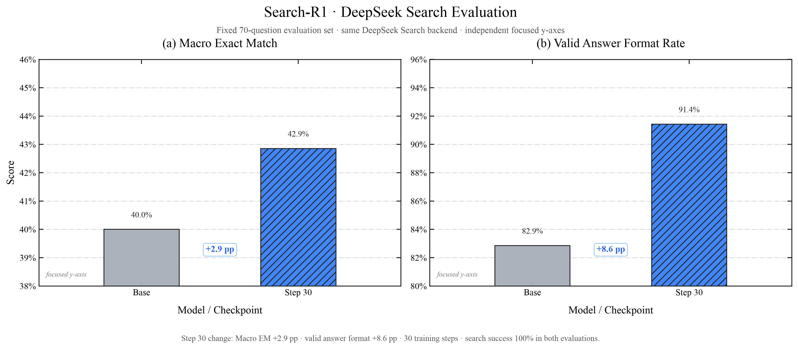
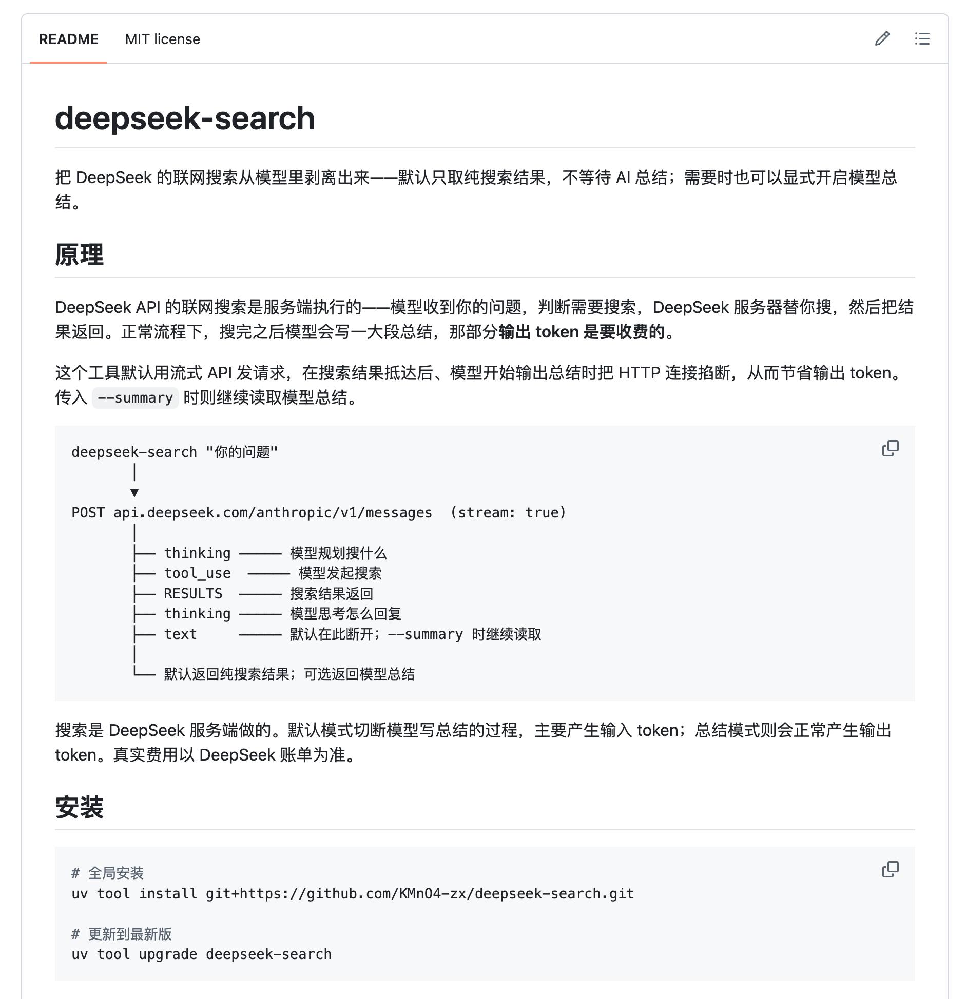
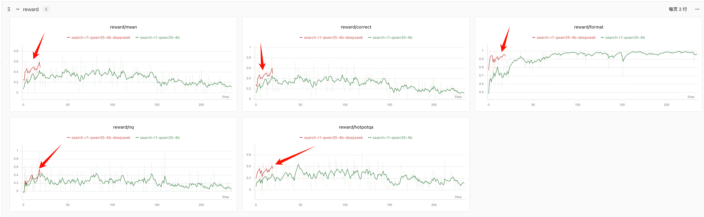

# 接下来我将复现 10 篇强化学习算法：第 3 篇，用 DeepSeek 搜索复现 Search-R1

> 想跳过正文直接运行？请查看 [快速启动指南](./start.md)：准备数据 → 训练 → 评测。


<div align="center">
  <a href="https://www.zhihu.com/people/feng-qi-xia-pian" target="_blank"></a>
  <a href="https://www.xiaohongshu.com/user/profile/63c2055e000000002502c58c" target="_blank"></a>
  <a href="https://github.com/KMnO4-zx/agentic-rl-lab"></a>
</div>

> **代码与复现资源**
>
> - 本文完整代码：[KMnO4-zx/agentic-rl-lab/03-search-r1](https://github.com/KMnO4-zx/agentic-rl-lab/tree/main/03-search-r1)
> - SwanLab · 本次 DeepSeek 官方搜索训练：[30-step 训练记录](https://swanlab.cn/@kmno4/agentic-rl-lab-search-r1/runs/2rxzhig0/chart)
> - SwanLab · 旧 DeepSeek Evidence 训练：[20-step 历史记录](https://swanlab.cn/@kmno4/llm-agent-rl-lab-search-r1/runs/06e4gw6a/chart)
> - Search-R1 论文：[Search-R1: Training LLMs to Reason and Leverage Search Engines with Reinforcement Learning](https://arxiv.org/abs/2503.09516)
> - DeepSeek 官方搜索 API：[网页搜索与抓取指南](https://api-docs.deepseek.com/zh-cn/guides/search/)
> - PyTRIO Skill：[SwanHubX/pytrio-skill](https://github.com/SwanHubX/pytrio-skill)

这是“接下来我将复现 10 篇强化学习算法”系列的第三篇。

前面三篇分别讲了：

- [第 0 篇：强化学习基础——损失函数](https://github.com/KMnO4-zx/agentic-rl-lab/blob/main/00-loss-function/readme.md)
- [第 1 篇：GRPO](https://github.com/KMnO4-zx/agentic-rl-lab/blob/main/01-grpo/readme.md)
- [第 2 篇：OPD](https://github.com/KMnO4-zx/agentic-rl-lab/blob/main/02-opd/readme.md)

这一次终于轮到我一直很想做的 Agentic RL：让模型在回答问题的过程中，自己决定什么时候搜索、搜索什么、看到搜索结果后要不要继续搜，最后再给出答案。

> **2026-10-20 更新：当前只保留两种搜索后端。** 默认的 `--search-backend deepseek` 直接调用 DeepSeek 官方 Search API，优先使用 `snippet` 短摘要；`--search-backend wikipedia` 免密钥搜索英文 Wikipedia。

这里的 **EM** 是 **Exact Match（精确匹配率）**。评测程序会从模型最终输出的 `Answer:` 中提取答案，统一转成小写、去除标点和英文冠词、合并多余空格，然后与任意一个参考答案比较。两者完全一致记为 `1`，其余情况记为 `0`，不会按关键词重合程度给部分分数。

**Macro EM** 会先分别计算 7 个 benchmark 的 EM，再对 7 项结果做等权平均，避免题量更大的数据集主导总分。本文的固定评测集中，每个 benchmark 都有 10 道题，因此这里的 Macro EM 也等于全部 70 道题的整体正确率。

这次接入 DeepSeek 官方 Search API 后，我又在同一套固定 70 题上评测了 Base Model 和 30-step checkpoint。两次评测都使用 Top 3 `snippet` 短摘要，搜索后端、并发和超时配置相同：



| DeepSeek Search | Macro EM | Format | 搜索成功率 |
| --- | ---: | ---: | ---: |
| Base Model | 40.00% | 82.86% | 100% |
| RL Step 30 | 42.86% | 91.43% | 100% |
| **变化** | **+2.86 pp** | **+8.57 pp** | — |

这轮训练后，Step 30 比 Base 净多答对 2 题，格式合规的回答增加了 6 题。两次评测的搜索成功率都是 100%，没有超时或 429。当前结果来自一次训练和 70 道题，说明本轮评测中的 EM 和 Format 都有提升，还需要更多题目与重复实验确认提升是否稳定。

这篇 Blog 的目标很简单：让普通开发者直接关注 Search-R1 最重要的算法结构。我们用 Qwen3.5-4B、PyTRIO 和可切换的在线搜索服务，把原本沉重的检索与训练基础设施压缩成一套可以直接运行的完整训练闭环。

## Search-R1 是从哪里来的？

Search-R1 是 Bowen Jin 等人在 2025 年提出的一项工作，全名是：

> Search-R1: Training LLMs to Reason and Leverage Search Engines with Reinforcement Learning

它想解决的问题很现实。

传统 RAG 通常是在模型回答前先检索一次：

```text
问题 → 检索 → 把结果塞进 prompt → 模型回答
```

这对于简单事实题很好用，但面对多跳问题，搜索通常需要进行多轮。比如：

```text
《小王子》的作者出生在哪个国家？
```

模型可能要先搜索：

```text
The Little Prince author
```

得到作者是 Antoine de Saint-Exupéry，再搜索：

```text
Antoine de Saint-Exupéry birthplace country
```

最后才能回答 France。

搜索引擎能搜到信息只是前提，真正困难的是让模型学会一连串决策：

- 当前信息够不够？
- 下一条 query 应该写什么？
- 搜索结果里哪个实体才是下一跳？
- 需要继续搜索，还是应该停止并回答？

如果这些决策只写在 prompt 里，模型是在推理时临时照着说明书操作。Search-R1 更进一步：它让模型通过强化学习，真正把“推理与搜索交替进行”学进参数里。

论文里最核心的变化可以概括成一句话：

> 搜索从回答前的固定步骤，变成了模型在整条推理轨迹中可以反复选择的动作。

## 用人话解释 Search-R1

可以把模型想象成一个参加开卷考试的学生。

普通 RAG 是老师先帮他查好一页资料，再让他作答。

Search-R1 则是把搜索框交给学生：他可以先想一会儿，输入一条 query，阅读结果；如果信息仍然不够，就换一个 query 再查；等他认为证据足够了，再写最终答案。

考试结束后，我们只检查最终答案：

- 答对了，reward 高；
- 答错了，reward 低；
- 连规定的答案格式都没有写出来，再扣一点分。

然后把同一道题的多条轨迹放在一起比较。比组内平均水平好的轨迹被鼓励，比平均水平差的轨迹被压低。

整个过程如下：


这里有一个很容易误解的点：

> Search-R1 的训练对象是大模型的 LoRA 权重；搜索引擎和 embedding 模型都作为固定环境保留。

模型学习的是：什么时候调用工具、怎样构造 query、如何使用返回的证据，以及什么时候停止搜索并回答。

## 我们是怎么复现的？

原版 Search-R1 建立在 veRL 上，官方 Quick Start 默认下载 Wikipedia corpus 和 E5 索引，再单独启动一个本地 retriever server。

我最开始也想照着原版做。但把数据库下载并解压后，体积大约 160 GB；如果希望检索服务在训练期间流畅运行，服务器还需要大约 180 GB 内存。对于严谨复刻论文环境来说，这些资源当然有意义；第一次学习 Search-R1 时，这套基础设施也很容易分散我们对算法本身的注意力。

很多人还没来得及深入 reward、advantage 或 loss mask 等关键算法部分，就先卡在了一系列与算法无关的工程问题上：

```text
索引怎么下载？
为什么解压后磁盘不够？
Faiss 为什么启动失败？
retriever server 为什么 OOM？
训练卡和检索卡应该怎么分？
```

这些问题都是真实的工程问题，与 reward、advantage 和 loss mask 等核心算法还有一段距离。

所以我把本地 retriever 换成了一个可切换的在线搜索环境：

```text
原论文：本地 Wikipedia corpus + E5 retriever
本文：  DeepSeek 官方 Search API（默认，使用 snippet 短摘要）
        或 Wikipedia Action API
```

Search-R1 官方代码本身也支持把本地检索器替换成在线搜索引擎，因为算法只要求存在这样一个接口：

```text
search(query) → observations
```

只要模型仍然需要自己生成 query、读取 observation、继续推理并获得最终 reward，Search-R1 的核心训练闭环就没有改变。

当前 DeepSeek 后端直接调用官方 `POST https://api.deepseek.com/v1/tools/search`，每次默认取 Top 3。工具 observation 保留标题、`snippet` 短摘要、来源和 URL，`snippet` 缺失时才回退到 `summary`；请求固定 `need_content=false`，无需额外调用模型整理证据，也无需 Fetch 页面。模型继续负责生成 query、判断证据、追加搜索和输出最终答案。

两个后端共用同一个 `search(query) → observations` 接口：

| 搜索后端 | 返回内容 | 默认并发 | 默认超时 | 成本与稳定性 |
| --- | --- | ---: | ---: | --- |
| DeepSeek 官方 Search API | Top 3 网页短摘要、标题、来源和 URL | 16 | 60 秒 | 每千次有效请求 5 元，按次数计费 |
| Wikipedia | Top 3 英文词条正文片段和 URL | 3 | 15 秒 | 免费、无需 API Key，证据范围限于 Wikipedia |

Wikipedia 客户端使用可识别的 User-Agent，并把所有并发请求的启动速率限制在约 200 RPM，以遵循 [Wikimedia API 的公开限额](https://www.mediawiki.org/wiki/Wikimedia_APIs/Rate_limits)。一次 Action API 请求会同时完成全文检索并取得 Top 3 页面正文，不需要额外抓取页面。

官方 Search API 的 `count` 不影响单次请求价格；只有 HTTP 200 且结果非空的请求计费。当前账号级限速为 100 QPS。计费与免费期以[官方说明](https://api-docs.deepseek.com/zh-cn/guides/search/#计费)为准；其中 2026 年 11 月 1 日开始收费的说明明确针对 Harness、Claude Code、Codex 中的服务端工具调用。

下文历史 20-step 实验使用的是旧 `deepseek-search` Evidence 接入，当日消费约为 `14.06` 元，包含搜索模型的 token 用量，不能作为官方 Search API 的成本或效果记录。

我们的实现配置如下：

| 项目 | 本文实现 |
| --- | --- |
| Base Model | `Qwen/Qwen3.5-4B` |
| 训练参数 | LoRA rank 32 |
| 训练框架 | PyTRIO |
| 搜索环境 | DeepSeek 官方 Search API / Wikipedia，可通过参数切换 |
| 训练数据 | NQ + HotpotQA |
| 每个 step | 8 道问题 |
| 每道问题 | 8 条轨迹 |
| 最大搜索次数 | 4 |
| 最大 assistant turns | 6 |
| 最大轨迹长度 | 8,192 tokens |
| Reward | Exact Match + Format |
| Advantage | `reward - group_mean` |
| Loss | `importance_sampling` |

这次复现聚焦于**核心算法**，不追求逐项复刻原论文的基础设施和最终分数：保留问题、工具、环境交互、group-relative advantage、retrieved-token mask 和 policy update，把最重的本地检索基础设施换成更容易获得的在线搜索服务。

我认为这对于学习算法更有价值。希望免密钥完整跑通流程时可以选择 Wikipedia，需要通用网页覆盖和更高并发时可以选择 DeepSeek 官方 Search API。等真正需要追求论文指标时，再把 `search(query)` 换回本地 Wikipedia retriever。

## 为什么我觉得 PyTRIO 很适合 Agentic RL？

我以前也尝试过用 veRL 等框架做强化学习。它们当然很强，但如果我只是想研究一个算法，往往要先处理训推一体、模型权重同步、vLLM、分布式训练和多卡资源调度。

Agentic RL 又比普通数学 RL 更麻烦。一次 rollout 里面不只有模型生成：

```text
模型生成 → 工具调用 → 等待环境 → 模型继续生成 → 再调用工具 → ……
```

如果自己租一台 8 卡机器，模型等待搜索 API 时 GPU 可能空着；训练侧等待长尾 rollout 时 GPU 也可能空着，但机器仍然按整段时间计费。

这里最关键的区别是**计费单位**。租 GPU 机器通常按占用时间收费：从任务启动到任务结束，8 张卡无论在训练、等待搜索，还是等待最慢的 rollout，整段 wall-clock time 都要付费。Agentic RL 的工具调用和轨迹长度又很不稳定，GPU 空转很容易成为一笔真实成本。

PyTRIO 的训练侧按实际处理的训练 Token 计费。模型等待搜索 API、本地 Python 执行工具、训练侧等待长尾 rollout 的这段时间都不会产生训练 Token，因此也不会继续累积训练费用。算力本身依然有成本，但我们无需为搜索和调度造成的 GPU 空转买单，这种计费方式天然适合 Search-R1 一类“环境交互时间长、有效训练时间短”的 Agentic RL 任务。

下面是早期实验保存的账单与价格截图。两笔 PyTRIO 会话分别是评测 `0.44` 元、训练 `13.30` 元。原始封面里“一杯喜茶”的说法，就来自这组历史账单与当时的价格截图。


<p align="center">
  
</p>

PyTRIO 把这个分工拆得很舒服：

- 本地 Python：数据、工具环境、rollout 状态机、reward、advantage、实验循环；
- PyTRIO：模型采样、前向、反向、LoRA optimizer、checkpoint 和 sampler weights。

本地代码只需要像普通 Python 一样调用：

```python
sampling_client = training_client.save_weights_and_get_sampling_client()

training_client.forward_backward(
    datums,
    loss_fn="importance_sampling",
).result()

training_client.optim_step(adam_params).result()
```

完整训练循环在 [`train.py`](https://github.com/KMnO4-zx/agentic-rl-lab/blob/main/03-search-r1/train.py)。

这样一来，我可以直接使用远端训练服务，也可以让 rollout 和 trainer 保持清晰分工。对这类“生成和工具调用耗时较长、backward 时间相对较短”的任务，按实际训练 Token 使用远端训练服务会自然很多。

这也是我觉得 PyTRIO 很像一种属于未来的模型训练基础设施的原因：研究者写的是算法和实验，底层训练服务更像随用随取的算力 API。

## 30-step 训练后的评测结果

本次训练使用 DeepSeek 官方 Search API。评测集固定为 70 道题，包含 7 个 benchmark，每个 benchmark 10 道题。Base 和 Step 30 使用相同的题目、工具协议、Top 3 `snippet` 摘要及搜索配置。

| 模型 / Checkpoint | Macro EM | Format | 2Wiki | Bamboogle | HotpotQA | MuSiQue | NQ | PopQA | TriviaQA |
| --- | ---: | ---: | ---: | ---: | ---: | ---: | ---: | ---: | ---: |
| Qwen3.5-4B | 40.00% | 82.86% | 50% | 70% | 70% | 10% | 20% | 10% | 50% |
| RL Step 30 | 42.86% | 91.43% | 40% | 60% | 70% | 10% | 30% | 30% | 60% |

相较于 Base，Step 30 的 Macro EM 从 `40.00%` 升至 `42.86%`，即答对题数从 28 题增加到 30 题；Format 从 `82.86%` 升至 `91.43%`，格式合规的回答从 58 题增加到 64 题。

两次评测的搜索成功率都是 `100%`，没有超时、429 或请求错误。平均搜索次数从每题 `1.76` 次增加到 `2.77` 次。它说明本轮训练改变了搜索和作答行为，并在这批题目上带来了提升；当前仍只有一次训练和 70 道开发题，需要更多题目与重复实验确认提升是否稳定。

### 旧 DeepSeek Evidence：稳定环境下的 20-step 历史实验

另外保留一组旧 `deepseek-search` Evidence 后端的 20-step 历史实验。它的 Base Model 和 Step 20 checkpoint 使用同一个搜索环境完成固定 70 题评测，与上面的官方 Search API 实验分别比较。

训练日志：[SwanLab · 旧 DeepSeek 20-step 实验](https://swanlab.cn/@kmno4/llm-agent-rl-lab-search-r1/runs/06e4gw6a/chart)。

下面是当时使用的工具界面，保留为历史记录；当前运行方式见[快速启动指南](./start.md)。



各 benchmark 的结果如下：

| 模型 / Checkpoint | Macro EM | Format | 2Wiki | Bamboogle | HotpotQA | MuSiQue | NQ | PopQA | TriviaQA |
| --- | ---: | ---: | ---: | ---: | ---: | ---: | ---: | ---: | ---: |
| Qwen3.5-4B | 44.29% | 88.57% | 50% | 70% | 60% | 20% | 40% | 20% | 50% |
| **RL Step 20** | **50.00%** | **97.14%** | **60%** | 70% | **70%** | **30%** | 40% | **30%** | 50% |

这 20 个 step 带来了两项可以直接核对的变化：

```text
Macro EM: 44.29% → 50.00%（+5.71 pp，70 题中净增 4 题）
Format:   88.57% → 97.14%（+8.57 pp）
```

两次评测的 `search/success_rate` 都是 `100%`，`search/error_rate`、`search/429_rate` 和 `search/timeout_rate` 都是 `0`。因此，这组 Base 与 Step 20 的差异没有混入搜索失败或额度耗尽的问题。

下面保留旧 DeepSeek 实验的训练曲线截图。红线和绿线来自不同搜索环境，用于记录当时的 reward 变化；本次官方 Search API 的结果见前面的 Base / Step 30 对比图。

图中红线对应[旧 DeepSeek 20-step 训练](https://swanlab.cn/@kmno4/llm-agent-rl-lab-search-r1/runs/06e4gw6a/chart)，绿线对应[早期搜索实验训练](https://swanlab.cn/@kmno4/llm-agent-rl-lab-search-r1/runs/iy76hn51/chart)。



这组 20-step 结果证明了稳定搜索环境下的早期优化信号，也给出了更可靠的复现入口。它仍然是一条训练 run 和 70 道开发题，距离多随机种子、大评测集的正式结论还有一段距离。

## Search-R1 的训练闭环详细拆解

到这里，如果只想知道 Search-R1 是什么，其实已经够了。想直接跑代码的朋友可以直接去 GitHub 仓库 ：https://github.com/KMnO4-zx/agentic-rl-lab

后面这一部分会按真实代码，把一次训练 step 拆开。完整目录如下：

```text
03-search-r1/
├── prepare_data.py   # 下载并整理训练与评测数据
├── data.py           # 读取本地 JSONL
├── protocol.py       # search tool schema、prompt 和 tool-call 解析
├── search.py         # DeepSeek 官方 API / Wikipedia 两种搜索后端
├── rollout.py        # 多轮工具调用状态机
├── reward.py         # EM + Format reward
├── train.py          # PyTRIO Search-R1 训练循环
├── eval.py           # Base / checkpoint 统一评测
└── analyse.py        # 绘制 DeepSeek checkpoint 结果图
```

## 第一步：准备问题和答案

数据来自 Search-R1 官方公开的 [`PeterJinGo/nq_hotpotqa_train`](https://huggingface.co/datasets/PeterJinGo/nq_hotpotqa_train)，我们通过 ModelScope 镜像下载固定版本。

准备脚本在 [`prepare_data.py`](https://github.com/KMnO4-zx/agentic-rl-lab/blob/main/03-search-r1/prepare_data.py)。

训练集包含：

| 数据源 | 题目数 |
| --- | ---: |
| NQ | 79,168 |
| HotpotQA | 90,447 |
| 合计 | 169,615 |

训练时只需要四个字段：

```json
{
  "id": "...",
  "question": "...",
  "answers": ["..."],
  "data_source": "nq"
}
```

这里没有人工标注的搜索 query，也没有人工写好的推理轨迹。模型只拿到问题，后面的搜索过程由当前策略自己生成。

这点非常重要：

> 我们没有用 SFT 教模型模仿某条固定搜索路径。最终结果提供 reward，让模型自己探索更有效的搜索路径。

## 第二步：把搜索声明成模型工具

工具协议在 [`protocol.py`](https://github.com/KMnO4-zx/agentic-rl-lab/blob/main/03-search-r1/protocol.py)。

搜索工具的 schema 很短：

```python
SEARCH_TOOL = {
    "type": "function",
    "function": {
        "name": "search",
        "description": "Search the web for evidence. Use a concise English query.",
        "parameters": {
            "type": "object",
            "properties": {
                "query": {
                    "type": "string",
                    "description": "A concise English search query.",
                },
            },
            "required": ["query"],
        },
    },
}
```

每一轮都使用 Qwen3.5 自己的 chat template 注入工具：

```python
prompt_tokens = tokenizer.apply_chat_template(
    messages,
    tools=[SEARCH_TOOL],
    tokenize=True,
    add_generation_prompt=True,
    enable_thinking=False,
)
```

这里无需靠 stop word 猜模型是否想搜索。模型会生成结构化的 `<tool_call>`，`protocol.py` 再把它解析成 query；环境执行真实搜索后，以 `role="tool"` 把 observation 写回对话。

两个搜索后端都实现在 [`search.py`](https://github.com/KMnO4-zx/agentic-rl-lab/blob/main/03-search-r1/search.py)，训练和评测通过同一个工厂函数创建客户端：

```python
search_client = create_search_client(
    args.search_backend,
    Path(__file__).resolve().parent / ".env",
    count=args.search_count,
    timeout=args.search_timeout,
)
```

`DeepSeekSearchClient` 通过 `httpx` 直接发送 Bearer 鉴权请求，将官方响应的 `title`、`snippet`、`site_name`、`url` 映射为统一的 `SearchItem`；`WikipediaSearchClient` 通过一次 Action API 请求取得 Top 3 英文词条的正文片段和 URL。两个客户端最终都返回相同的 `SearchResult`。DeepSeek query 最长 128 个 Unicode 字符，超长或空 query 会返回可观察的工具错误，让模型在下一轮调整。

两个客户端都会记录成功率、错误率、429 和延迟。DeepSeek 额外记录实际 HTTP 请求数和满足计费条件的成功请求数，不再记录旧搜索模型的 token 指标。408、429、5xx 和网络超时会有限重试；鉴权和余额错误直接返回工具错误。工具结果通常按完整条目装入预算；首条证据过长时，仅缩短正文，保留标题和来源，避免整次搜索被丢弃。

## 第三步：让一组轨迹在搜索后真正分叉

这是多轮 Search-R1 实现里，我觉得最容易被忽略的细节。

同一道题第一次采样时，8 条轨迹拥有完全相同的 prompt，因此可以直接：

```python
sample_async(
    prompt=shared_prompt,
    num_samples=8,
)
```

但第一轮之后，8 条轨迹可能生成 8 个不同 query，也会得到 8 份不同搜索结果：

```text
query_i 不同
→ observation_i 不同
→ 下一轮 prompt_tokens_i 不同
```

这时已经不能继续对一个 shared prompt 使用 `num_samples=8`。代码必须把每条轨迹独立推进，用多个 `num_samples=1` 的请求并发执行。


完整状态机在 [`rollout.py`](https://github.com/KMnO4-zx/agentic-rl-lab/blob/main/03-search-r1/rollout.py)。核心结构是：

```text
第一轮：
每道题 1 个 shared prompt × num_samples=8

第一次搜索之后：
每条未结束轨迹 1 个独立 prompt × num_samples=1
多个 sample_async 用 asyncio.gather 并发
```

一条轨迹内部仍然严格串行：

```text
assistant generation
→ search(query)
→ tool observation
→ next assistant generation
```

不同轨迹之间才可以并发。这样既保留了每条 Agent 轨迹的因果顺序，又不会让 64 条轨迹完全串行等待。

下面这张图来自早期保存的一条 MuSiQue 评测轨迹，展示同一道题在 Base、Step 50 和 Step 200 上的搜索与作答过程。它适合用来观察实体链是否保留、模型何时停止搜索；单条历史案例的表现需要与对应实验的整体评测分开看。


## 第四步：只用最终答案计算 Reward

Reward 实现在 [`reward.py`](https://github.com/KMnO4-zx/agentic-rl-lab/blob/main/03-search-r1/reward.py)。

模型最终必须留下且只留下一个非空答案：

```text
Answer: <short answer>
```

我们使用三档 reward：

| 最终结果 | Reward |
| --- | ---: |
| 格式合法且答案正确 | `1.0` |
| 格式合法但答案错误 | `0.0` |
| 格式非法，或没有最终答案 | `-0.1` |

代码只有几行：

```python
def score_answer(text: str, references: list[str]) -> RewardResult:
    answer = extract_answer(text)
    if answer is None:
        return RewardResult(-0.1, False, False, None)
    exact_match = any(
        normalize_answer(answer) == normalize_answer(reference)
        for reference in references
    )
    return RewardResult(float(exact_match), True, exact_match, answer)
```

这里没有给“搜索了几次”单独奖励，也没有给中间 query 加人工分数。

原因是中间 reward 很容易诱导 reward hacking。比如奖励搜索次数，模型可能学会不停搜索；奖励关键词命中，又可能让模型只优化 query 表面形式。本文保持最简单的 outcome reward：最后答对就行，至于中间如何搜索，让策略自己探索。

## 第五步：在同一道题内部计算 Advantage

每道题采样 8 条轨迹，得到 8 个最终 reward。然后计算：

```math
A_i = r_i - \operatorname{mean}(r_1, r_2, \ldots, r_8)
```

代码在 [`rollout.py`](https://github.com/KMnO4-zx/agentic-rl-lab/blob/main/03-search-r1/rollout.py)：

```python
mean_reward = sum(item.reward for item in group) / len(group)
for item in group:
    item.advantage = item.reward - mean_reward
```

例如某一组 reward 是：

```text
[1.0, 0.0, 0.0, -0.1, 1.0, 0.0, 0.0, -0.1]
```

组内平均值为 `0.225`，那么三类轨迹的 advantage 分别是：

```text
1.0  → +0.775
0.0  → -0.225
-0.1 → -0.325
```

同一道题里，相对更好的轨迹会被提高概率，相对更差的轨迹会被压低。

如果一整组 reward 完全一样，所有 advantage 都是 0，这一组不提供策略梯度；如果整个 rollout batch 的 advantage 都为 0，代码会跳过这次参数更新。这也是为什么搜索环境必须稳定：如果 API 错误让整组轨迹一起失败，我们就白白完成了一轮昂贵 rollout，却没有得到有效梯度。

## 第六步：搜索结果保留在上下文，但不参与 Loss

这是 Search-R1 和普通单轮 GRPO 最值得讲清楚的地方。

一条多轮轨迹里同时存在四类 token：

```text
system + user
assistant search(query)
tool observation
assistant final Answer
```

模型生成的 assistant token 是动作，应该参与策略更新；搜索 API 返回的 tool observation 是环境状态，它必须保留在上下文里，但不能当成模型生成的 token 去训练。


我们的处理方式无需额外发送 `mask` 字段，直接给 observation token 填入零 advantage 和零 old logprob：

```text
system / user / tool observation: advantage = 0
assistant tool call / final answer: advantage = trajectory_advantage
```

完整实现位于 [`train.py`](https://github.com/KMnO4-zx/agentic-rl-lab/blob/main/03-search-r1/train.py) 的 `build_datum()`。

核心逻辑如下：

```python
full_tokens += delta_observation + turn.completion_tokens
old_logprobs_by_token += [0.0] * len(delta_observation) + turn.logprobs
advantages_by_token += (
    [0.0] * len(delta_observation)
    + [trajectory.advantage] * len(turn.completion_tokens)
)

input_tokens = full_tokens[:-1]
target_tokens = full_tokens[1:]
old_logprobs = old_logprobs_by_token[1:]
advantages = advantages_by_token[1:]
```

随后构造 PyTRIO `Datum`：

```python
datum = trio.Datum(
    model_input=trio.ModelInput.from_ints(input_tokens),
    loss_fn_inputs={
        "target_tokens": np.asarray(target_tokens, dtype=np.int64),
        "logprobs": np.asarray(old_logprobs, dtype=np.float32),
        "advantages": np.asarray(advantages, dtype=np.float32),
    },
)
```

`input_tokens`、`target_tokens`、`logprobs` 和 `advantages` 必须经过同一次自回归右移，并且长度严格一致。old logprobs 必须来自 rollout 当时的 Student sampler，不能在模型更新后重新计算。

这样，搜索结果仍然影响后面的 assistant 决策，却不会被错误地当成模型动作参与 policy loss。

## 第七步：用完整轨迹更新策略

默认每个训练 step 包含：

```text
8 questions × 8 trajectories = 64 trajectories
```

先在每道题的完整 group 内计算 reward 和 advantage，再将全部轨迹构造成 `trio.Datum`，一次交给 `forward_backward`：

```python
datums = [build_datum(trajectory) for trajectory in trajectories]
if any(trajectory.advantage != 0.0 for trajectory in trajectories):
    result = training_client.forward_backward(
        datums,
        loss_fn="importance_sampling",
    ).result()
    training_client.optim_step(adam_params).result()
```

PyTRIO `0.2.9` 已支持自动梯度累加：SDK 根据服务端限制拆分物理请求，按完整 logical batch 归一化、累积梯度，并返回聚合后的训练指标。项目只保留单条训练 Datum 的 `8,192`-token 上限，直接使用 SDK 返回的 `loss_mean`。

advantage 为零的轨迹也保留在完整 batch 中，使 SDK 使用完整 rollout 的归一化分母；整批都没有训练信号时跳过参数更新。每个有效训练 step 调用一次 `forward_backward` 和一次 `optim_step`。

相关实现位于 [`train.py`](https://github.com/KMnO4-zx/agentic-rl-lab/blob/main/03-search-r1/train.py) 的 `build_datum()` 和训练主循环。

## 如何用 20 step 跑出效果？

下面是我建议读者实际复现的路径。它直接运行完整的 Search-R1 训练，没有为了测试额外增加简化分支。

### 1. 安装项目并登录

```bash
git clone https://github.com/KMnO4-zx/agentic-rl-lab.git
cd agentic-rl-lab

uv sync
trio login
swanlab login
```

训练和采样由 PyTRIO 远端服务完成，本地只需要 CPU 环境。

### 2. 下载并整理数据

```bash
uv run python 03-search-r1/prepare_data.py
```

完成后会生成：

```text
03-search-r1/datasets/
├── train.jsonl    # 169,615 道训练题
├── dev.jsonl      # 固定 70 道评测题
└── test.jsonl     # 完整评测池
```

### 3. 选择并配置搜索后端

先复制环境变量模板：

```bash
cp 03-search-r1/.env.example 03-search-r1/.env
```

默认使用 DeepSeek 官方 Search API。在 `03-search-r1/.env` 中填写：

```dotenv
DEEPSEEK_API_KEY=your_deepseek_api_key
```

也兼容 `DEEPSEEK_KEY`；进程中已设置的同名环境变量优先。无需安装或登录旧的 `deepseek-search` 工具。

如果希望使用无需 API Key 的公开后端，选择 `--search-backend wikipedia` 即可。它搜索英文 Wikipedia，默认并发为 `3`，默认超时为 `15` 秒，不需要修改 `.env`。

开始正式训练前，先确认 `search/success_rate` 正常。

### 4. 运行 20-step 小规模训练

进入 Search-R1 目录：

```bash
cd 03-search-r1
```

使用 DeepSeek Search：

```bash
uv run python train.py \
    --max-steps 20 \
    --questions-per-batch 8 \
    --group-size 8 \
    --save-every 5 \
    --base-model Qwen/Qwen3.5-4B \
    --search-backend deepseek \
    --run-name search-r1-qwen35-4b-deepseek \
    --swanlab-mode online
```

使用 Wikipedia：

```bash
uv run python train.py \
    --max-steps 20 \
    --questions-per-batch 8 \
    --group-size 8 \
    --save-every 5 \
    --base-model Qwen/Qwen3.5-4B \
    --search-backend wikipedia \
    --run-name search-r1-qwen35-4b-wikipedia \
    --swanlab-mode online
```

DeepSeek 默认使用 `16` 个搜索并发和 `60` 秒超时；Wikipedia 默认使用 `3` 个搜索并发和 `15` 秒超时。需要调整时可以传入 `--search-concurrency` 和 `--search-timeout`。DeepSeek 的结果条数可通过 `--search-count` 调整，默认 `3`，范围 `1～50`。正式训练可以把 `--max-steps` 改为 `100`，并把 `--save-every` 改为 `50`。

这 20 个 step 每步使用 8 道问题，每道问题采样 8 条真实多轮工具轨迹。每 5 step 会保存一次：

```text
*-state    # 用于断点续训
*-weights  # 用于采样与评测
```

20 step 已经足够观察：

- `reward/format` 是否明显上升；
- 模型是否开始稳定生成最终 `Answer:`；
- `reward/correct` 是否出现早期变化；
- 平均搜索次数和 assistant turns 是否变化；
- `search/success_rate` 是否仍然稳定；
- degenerate group 是否过多。

### 5. 评测 Base Model 和 Step 20

下面以 DeepSeek Search 为例。先评测 Base Model：

```bash
uv run python eval.py \
    --batch-size 16 \
    --base-model Qwen/Qwen3.5-4B \
    --search-backend deepseek \
    --search-count 3 \
    --search-concurrency 16 \
    --search-timeout 60 \
    --output eval_result/eval_results_base_deepseek_api.jsonl
```

训练结束时终端会打印 Step 20 sampler weights 路径。把它传给 evaluator：

```bash
uv run python eval.py \
    --batch-size 16 \
    --model-path 'trio://YOUR_STEP_20_SAMPLER_WEIGHTS' \
    --search-backend deepseek \
    --search-count 3 \
    --search-concurrency 16 \
    --search-timeout 60 \
    --output eval_result/eval_results_rl_step_20_deepseek_api.jsonl
```

使用 Wikipedia 后端时，两次评测都改成 `--search-backend wikipedia --search-concurrency 3 --search-timeout 15`。请为不同后端使用不同的输出文件名。Base 和 checkpoint 必须使用同一个搜索后端、摘要字段与同一组搜索配置。旧 Evidence 与官方 Search API 属于不同搜索环境，结果不能直接混比。

如果只想先检查整条链路，可以添加 `--limit 20`，再决定是否运行固定 70 题评测。

评测代码在 [`eval.py`](https://github.com/KMnO4-zx/agentic-rl-lab/blob/main/03-search-r1/eval.py)。它对 Base 和 checkpoint 使用相同的 tokenizer、工具协议、搜索环境、轨迹限制和 EM 规则。

### 6. 绘制评测结果

绘制本次 DeepSeek 官方 Search API 的 Base 与 Step 30 对比：

```bash
uv run python analyse.py --preset deepseek-api
```

该 preset 读取 `eval_result/eval_results_base.jsonl` 和 `eval_result/eval_results_rl_step_30.jsonl`，输出 `images/deepseek_api_base_vs_step30.png`。

绘制旧 DeepSeek Evidence 历史实验的 Base 与 Step 20 对比：

```bash
uv run python analyse.py --preset deepseek
```

绘图代码在 [`analyse.py`](https://github.com/KMnO4-zx/agentic-rl-lab/blob/main/03-search-r1/analyse.py)，直接读取每个 JSONL 末尾的 `summary.metrics`，并核对固定 70 题、搜索 API 或模型、摘要字段和搜索配置是否一致。

## 训练时最应该看哪些指标？

Search-R1 不能只看一个 reward 曲线。

| 指标 | 它在回答什么问题？ |
| --- | --- |
| `reward/mean` | 当前整条轨迹的平均结果如何？ |
| `reward/correct` | 最终答案正确率是否变化？ |
| `reward/format` | 模型是否学会结束搜索并按格式回答？ |
| `rollout/search_calls` | 每条轨迹平均搜索多少次？ |
| `rollout/turns` | 多轮轨迹变长还是变短？ |
| `rollout/degenerate_group_rate` | 多少问题没有组内相对训练信号？ |
| `train/loss_tokens_per_rollout_batch` | 实际有多少 assistant token 参与 loss？ |
| `search/success_rate` | 模型拿到的工具环境是否可靠？ |
| `search/error_rate` | reward 是否可能被外部错误污染？ |
| `search/latency` | 工具调用是否成为 rollout 瓶颈？ |
| `search/results` | 每次搜索平均返回多少条证据？ |
| `search/api_requests` / `search/billable_requests` | 每次工具调用实际发送多少 HTTP 请求，其中多少满足按次计费条件？ |

如果 `reward/correct` 下跌，同时 `search/error_rate` 上升，不能立刻得出模型退化的结论。先确认环境，再解释策略。

这也是 Agentic RL 和纯数学 RL 很不一样的地方：数学题的 verifier 通常是确定的，但工具环境可能超时、限流、返回空结果，甚至随着时间变化。环境质量本身就是实验变量。

## 这次复现有哪些边界？

第一，本文聚焦于复现 Search-R1 的核心算法，未逐项还原原论文的完整基础设施与 benchmark 分数。我们替换了模型、搜索后端、训练框架和部分训练配置，所以绝对指标不能与论文直接比较。

第二，当前评测只有固定 70 道题，每个 benchmark 10 道，适合检查行为变化和发现实现问题，但不能替代更大规模、多随机种子的正式实验。

第三，本次官方 Search API 的 Base 与 Step 30 使用相同的搜索配置，两次搜索成功率都是 100%。本轮评测观察到 `+2.86 pp` Macro EM 和 `+8.57 pp` Format，但一条训练 run 仍不足以给出稳定泛化结论。

第四，DeepSeek Search 与 Wikipedia 返回的证据范围不同，旧 Evidence 接入与官方 Search API 也属于不同搜索环境。本文只在各自相同的搜索环境内比较 checkpoint。

在这些边界内，本文仍然完成了最重要的目标：让大家用很小的存储、算力和金钱成本，真正把 Search-R1 从代码跑起来，并理解每一部分为什么存在。

## 小结

Search-R1 看起来像一个复杂的 Agent 训练系统，但拆开以后，它的核心非常朴素：

```text
1. 给模型一个问题和搜索工具。
2. 让当前策略生成多轮 search / observation / answer 轨迹。
3. 只根据最终答案计算 reward。
4. 在同一道题的多条轨迹之间计算相对 advantage。
5. 只训练模型生成的 assistant action token。
6. 用 PyTRIO importance_sampling 更新 LoRA。
7. 导出新 sampler，继续下一轮 rollout。
```

它把优化目标放在了主动从环境里获取知识的能力上。

原论文的 160 GB 检索数据库和约 180 GB 内存需求，对于严格复刻论文当然有价值；在学习算法的阶段，先承担这套基础设施会带来很高的成本。本文用可切换的在线搜索服务替代本地检索器，把进入 Search-R1 的门槛降到了普通开发者能够接受的程度。

本次 30-step 训练已经能观察到 Format Rate 和搜索行为的变化，并在固定 70 题评测中提高了 EM。希望免密钥运行时可以使用 Wikipedia；需要通用网页覆盖和更高并发时可以使用 DeepSeek 官方 Search API。

对我来说，这也是 PyTRIO 最吸引人的地方：我终于可以把时间集中在 reward、rollout、loss mask 和实验设计上，省去维护庞大训推集群的前置负担。

我越来越相信，未来训练模型也会像今天调用云数据库或对象存储一样自然。我们写普通 Python 描述算法，把采样、训练和 checkpoint 当作远端能力使用。至少对于个人研究者和小团队来说，这会释放出非常多原本被基础设施挡住的实验。

下一篇复现什么，我再想想。可能是 GSPO or OPSD，也可能又会突然冒出一个更好玩的 Agentic RL 想法哈哈哈。


## 参考资料

### 论文与官方实现

1. Bowen Jin et al. [Search-R1: Training LLMs to Reason and Leverage Search Engines with Reinforcement Learning](https://arxiv.org/abs/2503.09516), 2025.
2. Bowen Jin et al. [An Empirical Study on Reinforcement Learning for Reasoning-Search Interleaved LLM Agents](https://arxiv.org/abs/2505.15117), 2025.
3. [PeterGriffinJin/Search-R1](https://github.com/PeterGriffinJin/Search-R1)

### 数据、模型与搜索

1. [PeterJinGo/nq_hotpotqa_train](https://huggingface.co/datasets/PeterJinGo/nq_hotpotqa_train)
2. [Qwen/Qwen3.5-4B](https://huggingface.co/Qwen/Qwen3.5-4B)
3. [DeepSeek 官方 Search API](https://api-docs.deepseek.com/zh-cn/api/search/)
4. [Wikimedia Action API](https://www.mediawiki.org/wiki/API:Main_page)

### 本文实现

1. [Search-R1 PyTRIO 完整代码](https://github.com/KMnO4-zx/agentic-rl-lab/tree/main/03-search-r1)
2. [PyTRIO 文档](https://docs.pytrio.cn/)
3. [SwanLab 文档](https://docs.swanlab.cn/)
